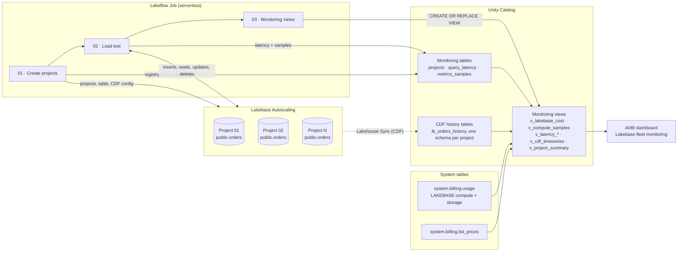

# Lakebase Monitoring Example

**How do you monitor many Lakebase projects from one place?** A team that runs one Lakebase project can
open its Monitoring page. A platform team that runs five, or fifty, needs the same five answers for the
whole fleet, side by side: *what does storage cost, what does compute cost, how busy is each compute, how
fast are queries, and how far behind is change data feed replication?*

This repo is one Databricks build that answers them. It creates a small fleet of Lakebase Autoscaling
projects with change data feed (Lakehouse Sync) enabled, runs a write and read load test against all of
them, and puts the five metrics on a single AI/BI dashboard. Cost comes from the billing system tables;
nothing is estimated. All data is synthetic and generated by the load test; no customer data is used.

It deploys as a Declarative Automation Bundle: one job, three notebooks, one dashboard.

## The five metrics

| Metric | Source | Scope |
| --- | --- | --- |
| **Storage cost** | `system.billing.usage` × `system.billing.list_prices` | Billed since each project was created, list price |
| **Compute cost** | `system.billing.usage` × `system.billing.list_prices` | Billed since each project was created, list price |
| **CU utilization** | Database load ÷ allocated vCPUs, sampled in each project | Latest load-test run |
| **P95 query latency** | Client-side timing of every statement | Latest load-test run |
| **CDF replication latency** | Lakehouse Sync history tables in Unity Catalog | Latest load-test run |

## The journey in 4 steps

| # | Step | What it does here | Where |
| --- | --- | --- | --- |
| 1 | **Lakebase projects** | Creates N Autoscaling projects (Postgres 17, 0.5 to 4 CU), an `orders` table in each, and a CDF config that replicates it to Unity Catalog | [`src/notebooks/01_create_lakebase_projects.py`](src/notebooks/01_create_lakebase_projects.py) |
| 2 | **Load test** | Per project, in parallel: 100,000 rows ingested, 20,000 reads, 5,000 updates, 500 deletes; times every statement and samples each project every 5 seconds | [`src/notebooks/02_load_test.py`](src/notebooks/02_load_test.py) |
| 3 | **Monitoring views** | Unity Catalog views that join billing system tables, load-test results and CDF history into one model | [`src/notebooks/03_create_monitoring_views.py`](src/notebooks/03_create_monitoring_views.py) |
| 4 | **AI/BI dashboard** | Fleet view of the five metrics with a project filter | [`src/dashboards/`](src/dashboards/) |

## Architecture



## How each metric is defined

**Storage cost and compute cost.** Lakebase usage is recorded in `system.billing.usage` with
`billing_origin_product = 'LAKEBASE'`.

| `usage_type` | Unit | Record | Detail in `product_features.lakebase` |
| --- | --- | --- | --- |
| `COMPUTE_TIME` | DBU | One per endpoint every 10 minutes | `compute_type` |
| `STORAGE_SPACE` | DSU | One per branch every hour | `storage_type` |

Each record identifies the project in `usage_metadata.project_id`. That value is the project **UID**, not
its name, so notebook 01 stores the UID in a registry table and the cost view joins on it. Usage is
multiplied by `pricing.effective_list.default` from `system.billing.list_prices`, so amounts are list price
in USD and do not include negotiated discounts.

**CU utilization.** Database load divided by the vCPUs allocated to the compute, capped at 100%. Database
load is the rate of change of `pg_stat_database.active_time`: seconds of statement execution per second of
wall clock, which is the average number of sessions executing a statement. Allocated vCPUs come from
`neon_utils.num_cpus()`.

**P95 query latency.** The 95th percentile of each statement's client-side latency, from just before the
statement is sent to just after its result is fetched. It includes the network round trip between the job
compute and the Lakebase endpoint.

**CDF replication latency.** For every replicated insert and update, the time between the commit in
Postgres (`created_at` or `updated_at`, both set with `clock_timestamp()`) and the `_timestamp` Lakehouse
Sync wrote to the history table. Deletes and update pre-images are counted as events but carry no fresh
source timestamp, so they have no latency.

## Measured results

From a run on 2026-11-26 with 5 projects, each autoscaling between 0.5 and 4 CU.

| Stage | Result |
| --- | --- |
| Projects | 5 projects created with the table and CDF config; Lakehouse Sync reported `STREAMING` on all 5 |
| Ingest | 500,000 rows (100,000 per project) in 500-row batches; P95 batch latency 146 to 162 ms |
| Reads | P95 across all reads about 12 ms per project; by type: point lookup 9.7 to 9.9 ms, index lookup 10.0 to 10.2 ms, range scan 12.5 to 13.4 ms, aggregate 15.3 to 16.2 ms |
| Updates and deletes | P95 4.9 to 6.3 ms for single-row updates, 4.7 to 6.3 ms for single-row deletes |
| CDF replication | 525,000 change events replicated; P95 latency 0.40 to 0.54 s, worst single event 0.7 s |
| CU utilization | 19% to 21% average per project over the run |
| Cost join | Checked against existing Lakebase usage in the workspace: every usage record matched exactly one list price |

## Decisions

| Decision | Trade-off accepted |
| --- | --- |
| Cost from `system.billing`, never estimated | Billing records arrive a few hours after the usage, so a new project shows $0 at first; the dashboard states how fresh the billing data is |
| List price (`pricing.effective_list`) | Not the invoiced amount for accounts with negotiated pricing |
| One Unity Catalog schema per project for CDF | Every project replicates a table with the same name, so they cannot share a schema; a `cdf_events` view unions them |
| Latency measured at the client | Includes the network round trip, which is what an application sees; server-side statement statistics are saved separately in `pg_stat_statements_snapshot` |
| CU utilization sampled inside each project | Covers the load-test window only; it does not depend on any preview feature |
| Views, not materialized tables | The dashboard always reads current billing data; every refresh queries the system tables |

## Run it

Deploy the bundle, then run the job. The job runs the three notebooks in order.

```bash
databricks bundle deploy \
  --var catalog=<catalog> \
  --var warehouse_id=<sql-warehouse-id> \
  --var project_prefix=<prefix>

databricks bundle run lakebase_monitoring \
  --var catalog=<catalog> \
  --var warehouse_id=<sql-warehouse-id> \
  --var project_prefix=<prefix>
```

Then open the **Lakebase fleet monitoring** dashboard. To run the load test again without touching the
projects:

```bash
databricks bundle run lakebase_monitoring --only load_test,create_monitoring_views \
  --var catalog=<catalog> --var warehouse_id=<sql-warehouse-id> --var project_prefix=<prefix>
```

| Variable | Default | Meaning |
| --- | --- | --- |
| `catalog` | `main` | Catalog for the monitoring schema and the CDF history schemas |
| `monitoring_schema` | `lakebase_monitoring` | Schema for the monitoring tables and views |
| `project_prefix` | `lb-monitoring-demo` | Projects are named `<prefix>-01`, `<prefix>-02`, ... |
| `num_projects` | `5` | Number of projects |
| `warehouse_id` | none, required | SQL warehouse used by the dashboard |

The notebooks also run on their own: each takes the same values as widgets.

**Needs:** Unity Catalog, serverless compute, a SQL warehouse, Lakebase Autoscaling with Lakehouse Sync,
`SELECT` on `system.billing.usage` and `system.billing.list_prices`, a catalog that does not use default
storage, and Databricks CLI 0.281.0 or later.

## Things to know

- **Billing data lags.** Right after the first run the cost tiles show $0 and a status row says no billing
  records exist yet. They fill in on their own, because `v_lakebase_cost` is a view over the system tables.
- **Performance views show the latest run.** Cost covers everything billed since the projects were created;
  utilization, latency and replication cover the most recent load-test run.
- **Every run adds data.** Each load-test run appends another 100,000 rows to every project.
- **The projects keep running.** The `production` branch suspends after 24 hours of inactivity by default,
  so the projects bill until they are deleted.
- **Lakebase telemetry system tables.** Workspaces with the *Lakebase Observability in System Tables*
  preview also get compute and database telemetry in the `system.lakebase` schema. This example does not
  depend on it.

## Clean up

```bash
databricks bundle destroy --var catalog=<catalog> --var warehouse_id=<sql-warehouse-id>

for i in 01 02 03 04 05; do
  databricks postgres delete-project projects/<prefix>-$i
done
```

Then drop the Unity Catalog schemas: `<catalog>.<monitoring_schema>` and one schema per project (the project
id with hyphens replaced by underscores).
